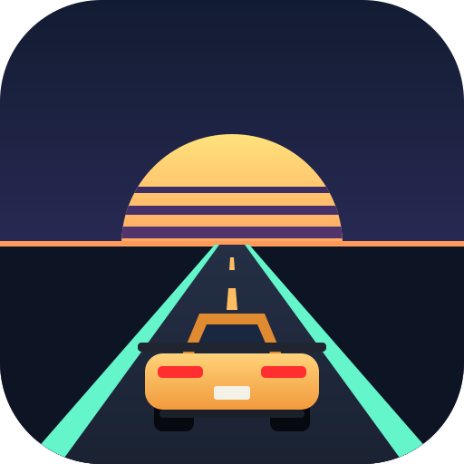

# CarRacing

CarRacing 是使用 Godot 4 制作的 3D 驾驶游戏原型。可驾驶 GT 赛车、拉力赛车、耐力原型车或六轮平板大货车，在公路远行中连续穿过沙漠、城市、隧道、草原和森林，也可以参加赛道练习。不同车辆拥有各自的加速、极速和操控特性。大货车约长 6.9 米，低矮的货物不会挡住车头，起步更慢、转向更稳，刹车需要预留更长距离。雨雪会影响车速和抓地力，天黑时前灯会自动亮起。

车速、车辆性能和道路限速统一使用 **mph（英里/小时）**。草原限速 55 mph，森林与隧道 45 mph，城市 30 mph，沙漠 65 mph。持续超出限速 11 mph 或低于限速 10 mph 会扣分，正常等红灯、STOP 停车和跟随慢车时豁免低速处罚。

- **对手赛车**：赛道练习可开启 3 名 AI 对手，倒计时发车。对手同样遵守信号灯、停车标志和人行横道，最终名次计入违规罚时。
- **幽灵车**：刷新个人纪录后，下次比赛会以半透明赛车重放最佳一圈。
- **漂移与氮气**：按住手刹转向可以漂移，漂移会积攒氮气，按氮气键释放加速。
- **每日挑战**：每天固定一组赛道、赛车、天气和昼夜，记录当天最佳成绩。
- **车漆涂装**：奖牌（铜 1、银 2、金 3 点）和每日挑战完成天数会累积奖牌点数，用来解锁车漆。
- **公路远行**：连续守规驾驶可提升得分倍数（最高 ×3）。油量会随行驶消耗，驶入右侧车道的加油站并慢行即可加油。
- **仪表盘**：转速表、车速表、限速牌、车灯和加速指示灯，以及氮气、燃油、油门和刹车条。

## 开始游戏

从 [GitHub Releases](https://github.com/AmoseCP/car-racing/releases/latest) 下载，无需安装 Godot。

- **Windows 电脑 / 掌机**：[单文件 EXE](https://github.com/AmoseCP/car-racing/releases/latest/download/CarRacing-Windows-x64.exe)，下载后直接运行；[完整 ZIP](https://github.com/AmoseCP/car-racing/releases/latest/download/CarRacing-Windows-x64.zip) 包含程序、操作说明和第三方许可。
- **Mac（M 系列芯片）**：[Apple Silicon ZIP](https://github.com/AmoseCP/car-racing/releases/latest/download/CarRacing-macOS-AppleSilicon.zip)，解压后打开 `CarRacing-macOS-AppleSilicon/CarRacing.app`。
- **Mac（Intel 芯片）**：[Intel ZIP](https://github.com/AmoseCP/car-racing/releases/latest/download/CarRacing-macOS-Intel.zip)，解压后打开 `CarRacing-macOS-Intel/CarRacing.app`。不确定时，可在「苹果菜单 → 关于本机」查看芯片型号。
- Mac 应用使用 ad-hoc 签名，尚未通过 Apple 公证；首次打开若被拦截，请右键选择「打开」。
- 单独下载 EXE 时，第三方素材与引擎的署名、版权和许可见同一发布页的 `THIRD_PARTY_LICENSES.zip`。

进入「赛车选择 → 大货车」可体验新增车型。Mac 版已实测；Windows 版已完成导出和资源包启动检查，尚未进行 Windows 实机测试。

| 操作 | 键盘 | 手柄 |
| --- | --- | --- |
| 油门 | W / ↑ | RT |
| 刹车和倒车 | S / ↓ | LT |
| 刹车（不倒车） | 空格 | LB |
| 转向 | A / D 或 ← / → | 左摇杆 |
| 手刹 / 漂移 | Q | A |
| 氮气加速 | Shift | B |
| 切换视角 | C | 视图键 |
| 切换车灯 | H | X |
| 重试 | R | Y |
| 暂停 | Esc | 菜单键 |
| 切换全屏 | F11 | 暂停菜单 |
| 画面模式（菜单中） | P | X |

在赛道选择页可调整天气和昼夜设置。

## 手柄与掌机

- **手柄检测**：主菜单或暂停菜单的「手柄与体感」会显示已连接的手柄和实时输入，可开关震动。插拔手柄时右上角会提示，驾驶中断开手柄会自动暂停。
- **Mac**：Xbox 手柄请在「系统设置 → 蓝牙」中配对，macOS 不支持 Xbox 手柄的 USB 有线连接；PlayStation 与 Switch Pro 手柄可用 USB 或蓝牙。在 Godot 编辑器中运行时，请在「游戏」面板关闭「嵌入游戏」，Godot 4.5 及以后版本的 macOS 嵌入窗口可能收不到手柄输入。
- **Windows 掌机**（ROG Ally、Legion Go、MSI Claw 等）：带触屏和内置手柄的 Windows 设备首次启动会默认使用「均衡 40 FPS」。在菜单中按 X / P 可在流畅 60、均衡 40、省电 30 FPS 之间切换。按掌机快捷键或打开 Xbox Game Bar 导致游戏失去焦点时会自动暂停。碰撞、漂移、氮气和驶离路面时有震动反馈。用手柄驾驶 8 秒后，操作提示会自动隐藏。
- **体感转向**：支持运动传感器的 Windows 掌机或手柄可在「手柄与体感」中开启。

## 从源码运行

用 Godot 4.7.2 打开 `project.godot`，等待素材导入后按 F5。安装同版本的 Godot 导出模板后，可使用项目中的 `Windows x64` 或 `macOS Universal` 预设导出发行版。Godot 官方模板只提供 Universal 版 Mac 程序，发行时用 `tools/split_macos_app.sh` 拆分为 Apple Silicon 与 Intel 两个版本。公开源码可独立运行，不需要编辑器 MCP 插件。

## 素材署名

赛车模型、场景素材和字体的来源与许可见 [美术素材署名](racing_prototype/art/CREDITS.txt) 和 [字体许可](racing_prototype/fonts/OFL.txt)。
